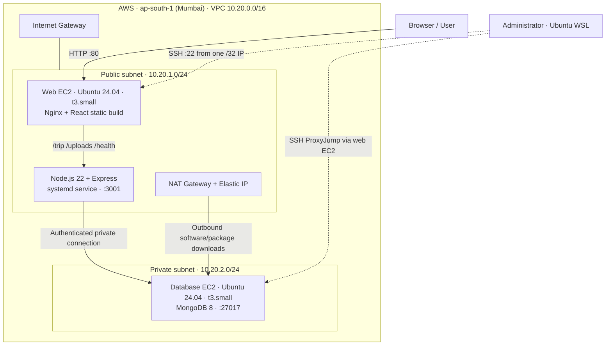
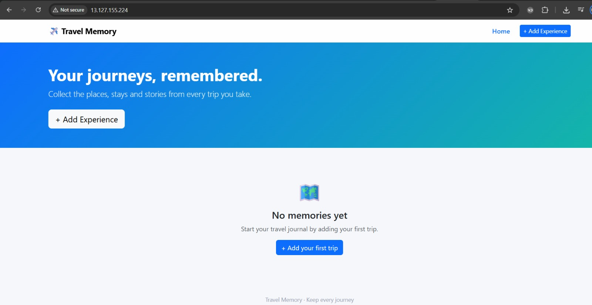
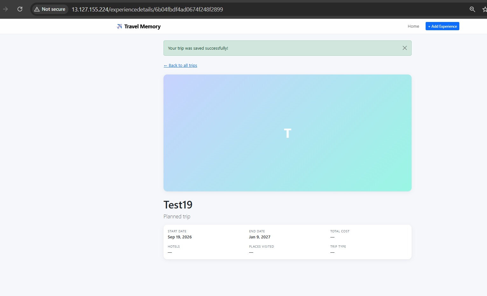
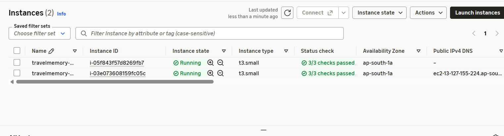
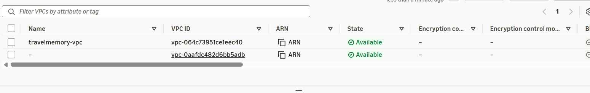
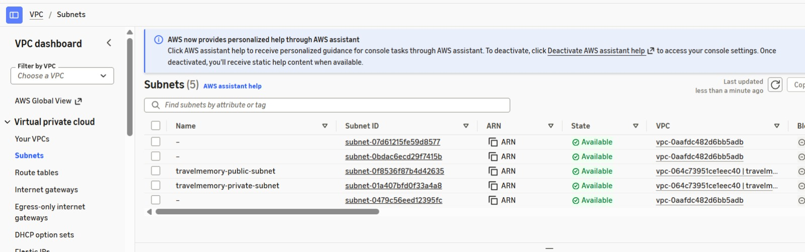
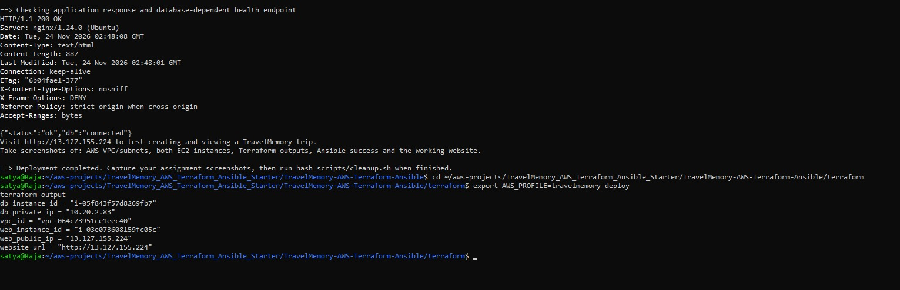
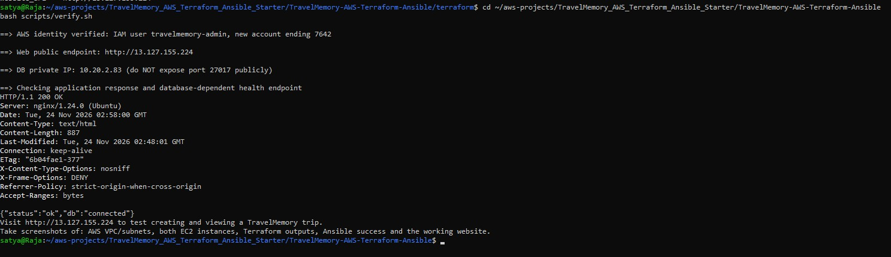

# TravelMemory MERN Application on AWS — Terraform & Ansible

**Infrastructure as Code | Configuration Management | AWS EC2 | VPC | MongoDB | Node.js | React | Nginx**

> **Assignment status: Deployment and automated verification completed on 24 November 2026.** Terraform provisioned the AWS infrastructure, and Ansible configured both EC2 instances and deployed the TravelMemory application. Screenshots captured during the deployment are included below. The demo URL uses an EC2 public IP and may stop working after the lab is destroyed.

This project deploys the open-source [TravelMemory MERN application by UnpredictablePrashant](https://github.com/UnpredictablePrashant/TravelMemory) to AWS using **Terraform** for infrastructure and **Ansible** for server configuration. The web application is publicly accessible over HTTP during the lab; MongoDB remains in a private subnet with authentication enabled.

## Table of contents

1. [Project objectives](#project-objectives)
2. [Architecture](#architecture)
3. [Technology stack](#technology-stack)
4. [AWS infrastructure and security](#aws-infrastructure-and-security)
5. [Repository layout](#repository-layout)
6. [Prerequisites](#prerequisites)
7. [Deployment instructions](#deployment-instructions)
8. [Verification and results](#verification-and-results)
9. [Project screenshots](#project-screenshots)
10. [Troubleshooting](#troubleshooting)
11. [Cost management and cleanup](#cost-management-and-cleanup)
12. [Assignment deliverables](#assignment-deliverables)
13. [Acknowledgements](#acknowledgements)

## Project objectives

The assignment was to:

- Create a custom **AWS VPC** with one public and one private subnet using Terraform.
- Configure an **Internet Gateway**, **NAT Gateway**, and the required routing.
- Provision **two EC2 instances**: one public web/application server and one private MongoDB server.
- Restrict SSH access to the administrator's public IP and permit database access only from the web server.
- Use Ansible to install and configure **Node.js, Express, React, Nginx, and MongoDB**.
- Configure MongoDB authentication, application environment variables, the reverse proxy, and persistent system services.
- Verify the functioning application, document the infrastructure, and capture screenshots for submission.

## Architecture



**Traffic flow:** The browser connects to Nginx on port 80. Nginx serves the compiled React frontend and proxies API requests (`/trip`, `/uploads`, `/health`) to the Express process listening on the web instance at port 3001. Express connects to MongoDB using the private database IP. The private database EC2 has **no public IP**; its outbound package downloads use the NAT Gateway. Ansible reaches it over SSH through the web EC2 jump host.

> This is an **educational two-tier deployment**, not a production/high-availability architecture. It intentionally uses HTTP (not HTTPS), a single web server, a single database server, and no automated backups or load balancer.

## Technology stack

| Layer | Technology | Role |
| --- | --- | --- |
| Cloud | Amazon Web Services (Mumbai region, `ap-south-1`) | Cloud infrastructure |
| Provisioning | Terraform `1.17.2` and AWS provider `6.73.0` | Infrastructure as Code |
| Configuration | Ansible Core `2.20.1` | Install/configure servers and deploy app |
| Operating system | Ubuntu Server `24.04` on EC2 | Server OS |
| Frontend | React | TravelMemory user interface |
| Backend | Node.js `22` and Express | REST API and application logic |
| Database | MongoDB `8.0` | Trip data persistence |
| Web server | Nginx | React static hosting and reverse proxy |
| Process manager | systemd | Manage Express service |
| Local environment | Windows + WSL Ubuntu, Git and AWS CLI | Deployment workstation |

The original TravelMemory application supports creating and viewing trips, with API routes such as `GET /trip`, `POST /trip`, and `GET /health`. Application source is **cloned from the upstream repository during Ansible deployment**; this repository focuses on the AWS automation and evidence.

## AWS infrastructure and security

Terraform creates **23 AWS resources** in the initial deployment plan, including:

| Component | Configuration / purpose |
| --- | --- |
| VPC | `10.20.0.0/16` |
| Public subnet | `10.20.1.0/24`, public web EC2 |
| Private subnet | `10.20.2.0/24`, MongoDB EC2 without public IP |
| Internet Gateway | Internet access for public subnet |
| NAT Gateway + Elastic IP | Outbound access from private subnet; **billable** |
| Route tables and associations | Internet Gateway route for public subnet; NAT route for private subnet |
| Web EC2 | Ubuntu 24.04, `t3.small`, encrypted 20-GiB gp3 root volume |
| Database EC2 | Ubuntu 24.04, `t3.small`, encrypted 20-GiB gp3 root volume |
| Security groups / ingress rules | HTTP from internet; SSH restricted to current administrator `/32`; private MongoDB/SSH from web security group only |
| EC2 IAM role / instance profile | AWS-managed `AmazonSSMManagedInstanceCore` attachment |
| EC2 SSH key pair | Existing ED25519 public key imported into the Mumbai region; private key stays on workstation |

### Security controls

- **Port 80:** Open to allow temporary public HTTP access to the TravelMemory website.
- **Port 22 (web EC2):** Open only from the administrator's configured IPv4 `/32`, **not** `0.0.0.0/0`.
- **Port 27017 (MongoDB):** Reachable only from the web EC2 security group, **not** the internet.
- **Port 22 (MongoDB):** Reachable from the web security group via SSH jump host.
- **MongoDB:** Authentication enabled, with separate administrative and application users.
- **Credentials:** Generated locally for deployment and excluded from Git; not embedded in Terraform files.
- **Instance metadata:** EC2 instances require IMDSv2 tokens.
- **Disk encryption:** Both EC2 root EBS volumes are encrypted.

## Repository layout

```text
TravelMemory-AWS-Terraform-Ansible/
├── .gitignore
├── README.md
├── Beginner_Setup_Guide.pdf
├── terraform/
│   ├── main.tf
│   ├── variables.tf
│   ├── outputs.tf
│   ├── versions.tf
│   ├── terraform.tfvars.example
│   └── .terraform.lock.hcl
├── ansible/
│   ├── ansible.cfg
│   ├── site.yml
│   └── templates/
│       ├── backend.env.j2
│       ├── bootstrap_mongo.js.j2
│       ├── mongod.conf.j2
│       ├── nginx.conf.j2
│       └── travelmemory.service.j2
├── scripts/
│   ├── _common.sh
│   ├── preflight.sh
│   ├── deploy.sh
│   ├── verify.sh
│   ├── cleanup.sh
│   ├── sync_public_ip.py
│   ├── generate_inventory.py
│   └── plan_summary.py
├── report/
│   ├── Implementation_Report_TEMPLATE.md
│   ├── Implementation_Report_TEMPLATE.pdf
│   └── Submission_Link_TEMPLATE.txt
└── screenshots/
    ├── Ansible.jpeg
    ├── EC2instances.jpeg
    ├── Terraformcmd.jpeg
    ├── Travelmemory.jpeg
    ├── Travelmemoryexample.jpeg
    ├── VPC.jpeg
    └── vpcsubnet.jpeg
```

`terraform.tfvars`, Terraform state, the generated Ansible inventory, `.travelmemory-secrets`, SSH private keys, and other credentials must **never** be committed. They are intentionally absent from the directory diagram.

## Prerequisites

- AWS account with EC2, VPC, IAM and NAT Gateway permissions and an active billing budget.
- **Dedicated non-root IAM identity** with MFA; this lab used an AWS CLI profile named `travelmemory-deploy`.
- Windows with **Ubuntu WSL**, or a Linux environment.
- Installed: AWS CLI v2, Terraform, Ansible, Python 3, Git, OpenSSH and curl.
- Existing ED25519 EC2 key pair named `travelmemory-aws-key` in `ap-south-1`; local private key at `~/.ssh/travelmemory-aws-key` (example deployment location).
- Your current public IPv4 address, used to restrict SSH.

### AWS CLI login

```bash
aws login --profile travelmemory-deploy --region ap-south-1 --remote
export AWS_PROFILE=travelmemory-deploy
aws sts get-caller-identity --query Arn --output text
```

Confirm that the returned identity is an **IAM user** (or other authorized non-root role) in the intended account. Do not put AWS access keys in this repository.

## Deployment instructions

### 1. Set up Terraform variables

```bash
cd terraform
cp terraform.tfvars.example terraform.tfvars
nano terraform.tfvars
```

Example configuration (replace the sample SSH IP with **your** current public IPv4 address):

```hcl
aws_region        = "ap-south-1"
admin_ip_cidr     = "203.0.113.10/32" # sample only: change it
key_name          = "travelmemory-aws-key"
web_instance_type = "t3.small"
db_instance_type  = "t3.small"
```

The `terraform.tfvars.example` in the starter may show a larger default web instance: the deployment documented here used **two `t3.small` instances**. The Ansible playbook adds a 2-GiB swapfile on the web server to help the React build complete on 2 GiB of RAM. A swapfile is a build aid, not a replacement for RAM.

### 2. Validate infrastructure configuration

```bash
terraform init
terraform fmt -check
terraform validate
terraform plan
cd ..
```

For the initial deployment, Terraform reported:

```text
Plan: 23 to add, 0 to change, 0 to destroy.
```

A successful plan does **not** create any resources.

### 3. Run the automated preflight

From the repository root:

```bash
export AWS_PROFILE=travelmemory-deploy
bash scripts/preflight.sh
```

The preflight checks AWS identity, EC2 SSH key registration, current SSH `/32` address, budget configuration and Terraform validity. It does **not** launch chargeable resources. Review any automatically updated SSH CIDR before deployment.

### 4. Deploy Terraform + Ansible

> **Billing warning:** The deployment creates billable AWS resources, particularly a NAT Gateway. AWS Budgets are alerts, **not hard spending limits**. Confirm the email alert is working and review costs before proceeding.

```bash
bash scripts/deploy.sh
```

The script:

1. Builds and summarizes a saved Terraform plan.
2. Requires typing `DEPLOY` as explicit confirmation.
3. Applies the Terraform plan to create AWS infrastructure.
4. Generates Ansible inventory using Terraform outputs.
5. Unlocks the SSH key using `ssh-agent` and connects through the web EC2 to MongoDB.
6. Generates local MongoDB credentials and stores them in `.travelmemory-secrets` with restricted permissions.
7. Runs `ansible-playbook site.yml` to configure MongoDB, Node.js, React, Nginx and systemd.
8. Verifies the website and `/health` endpoint.

**Do not delete your local Terraform state while resources exist.** It is required to manage and destroy the infrastructure.

### 5. Run verification separately

```bash
bash scripts/verify.sh
```

You can also inspect Terraform outputs:

```bash
cd terraform
terraform output
terraform output -raw website_url
cd ..
```

For an active deployment, open the output website URL in a browser. The EC2 public IP is temporary and can change if the environment is recreated.

## Verification and results

The deployment output captured on **24 November 2026** reported:

| Verification | Observed outcome |
| --- | --- |
| Terraform deployment | Infrastructure created and output values generated |
| Terraform initial plan | `23 to add, 0 to change, 0 to destroy` |
| Database Ansible run | `ok=16`, `changed=11`, `failed=0`, `unreachable=0` |
| Web Ansible run | `ok=33`, `changed=25`, `failed=0`, `unreachable=0` |
| Website | HTTP `200 OK` from Nginx |
| Backend and MongoDB health | `{"status":"ok","db":"connected"}` |
| User interface | Homepage and a sample travel-memory screenshot included below |

The screenshot of the example memory is provided as assignment evidence. This README records deployment-time observations; it does not claim that the demo remains online indefinitely.

### Main application API endpoints

| Request | Endpoint | Purpose |
| --- | --- | --- |
| `GET` | `/` | React frontend |
| `GET` | `/health` | API + MongoDB health |
| `GET` | `/trip` | List trips |
| `GET` | `/trip/:id` | View a trip |
| `POST` | `/trip` | Create a trip (JSON or multipart form data) |
| `GET` | `/uploads/:file` | Serve an uploaded trip image |

### Sample non-sensitive health check

```bash
# While the deployment is running, replace the example with the Terraform website URL:
curl -fsS "$(cd terraform && terraform output -raw website_url)/health"
# Expected: {"status":"ok","db":"connected"}
```

## Project screenshots

The images below are included using **relative paths**, so they render automatically in GitHub after the `screenshots/` folder has been pushed. If an image does not appear, verify that the filename and letter case match exactly.

### 1. TravelMemory homepage

The deployed React interface served through Nginx on the public web EC2 instance.



### 2. Sample travel memory

An example travel-memory entry captured from the application interface.



### 3. AWS EC2 instances

Two EC2 instances provisioned by Terraform: one public web server and one private MongoDB server.



### 4. AWS VPC

The custom TravelMemory VPC deployed in the Mumbai region.



### 5. AWS public and private subnets

The two Terraform-created subnets and their network details.



### 6. Terraform execution

Terraform provisioning/outputs captured during the assignment.



### 7. Ansible deployment results

Ansible execution and success evidence, including the zero-failure recap.



## Troubleshooting

| Problem | What to check |
| --- | --- |
| AWS CLI selects the wrong account | `export AWS_PROFILE=travelmemory-deploy` and `aws sts get-caller-identity` |
| Terraform cannot connect to AWS | Refresh `aws login`, confirm IAM permissions and region |
| SSH times out | Compare `admin_ip_cidr` with `curl -4 https://checkip.amazonaws.com`; check security group and key pair |
| Ansible cannot reach MongoDB EC2 | Public EC2 jump connection, generated inventory, private subnet SG rules, SSH agent |
| Website doesn't load | EC2 running, web security group port 80, Nginx service and web public IP |
| Website loads but API fails | `/health`, `travelmemory` systemd service, MongoDB service, private network and DB credentials |
| React build runs out of memory | Confirm swapfile and Node memory settings in `ansible/site.yml` |
| Budget shows unexpected charges | Check NAT Gateway, EC2, EBS, public IP and deleted resources in `ap-south-1` |

Useful checks on the web EC2 (connect using your own SSH configuration):

```bash
sudo systemctl status nginx
sudo systemctl status travelmemory
sudo journalctl -u travelmemory -n 50 --no-pager
```

## Cost management and cleanup

This lab used an **AWS budget of $12/month** with alert rules and promotional credits. The budget **does not automatically stop spending**. EC2, EBS storage, public IPv4 and particularly the NAT Gateway may consume credits until removed. Any credits, pricing or Free Tier eligibility depend on the AWS account and current AWS terms.

Once all screenshots and assignment evidence are saved, destroy the deployment from the repository root:

```bash
export AWS_PROFILE=travelmemory-deploy
bash scripts/cleanup.sh
```

The cleanup script displays the Terraform-managed resources and requires typing `DESTROY`. It runs `terraform destroy` for the resources tracked by this project's state. **The demo website will stop working**, and trip data stored on the EC2 volumes will be lost. Afterward, verify that the EC2 instances, NAT Gateway, associated Elastic IP, and volumes have been removed in the AWS Console.

Do not remove the Terraform state *before* cleanup. Keep it private and do not commit it to GitHub.

## Assignment deliverables

| Assignment requirement | Evidence in repository |
| --- | --- |
| AWS architecture using Terraform | [`terraform/`](terraform/) |
| Public/private subnets, NAT/IGW, routes, EC2 and IAM | [`terraform/main.tf`](terraform/main.tf) |
| Configuration and deployment with Ansible | [`ansible/site.yml`](ansible/site.yml) and [`ansible/templates/`](ansible/templates/) |
| Automated deployment, verification and teardown | [`scripts/`](scripts/) |
| Implementation report | [`report/Implementation_Report_TEMPLATE.md`](report/Implementation_Report_TEMPLATE.md) / [PDF](report/Implementation_Report_TEMPLATE.pdf) — **template; update with your final deployment information before submitting** |
| Screenshots of infrastructure, app and automation | [Screenshots section](#project-screenshots) and [`screenshots/`](screenshots/) |
| GitHub repository | This repository: [TravelMemory-AWS-Terraform-Ansible](https://github.com/Drstrange1919/TravelMemory-AWS-Terraform-Ansible) |

**Submission note:** Share the GitHub repository URL through the submission format required by your course. The report template is included but should be finalized with your actual results.

## Acknowledgements

- **TravelMemory application source:** [UnpredictablePrashant/TravelMemory](https://github.com/UnpredictablePrashant/TravelMemory). Application credits and license remain with the original author.
- **Infrastructure deployment and documentation:** This repository's Terraform, Ansible and automation scripts are for the AWS deployment assignment.
- **AWS learning lab:** Created for educational demonstration, not production use.
