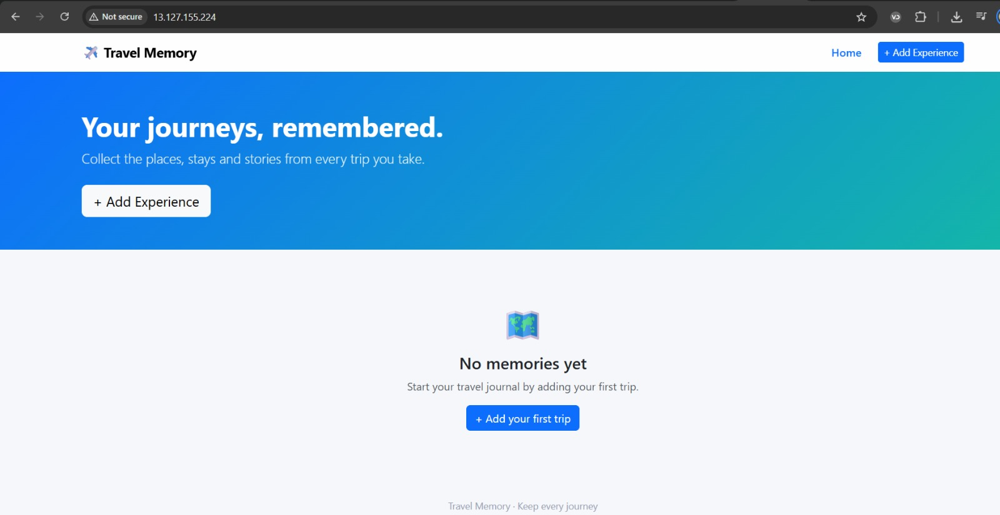
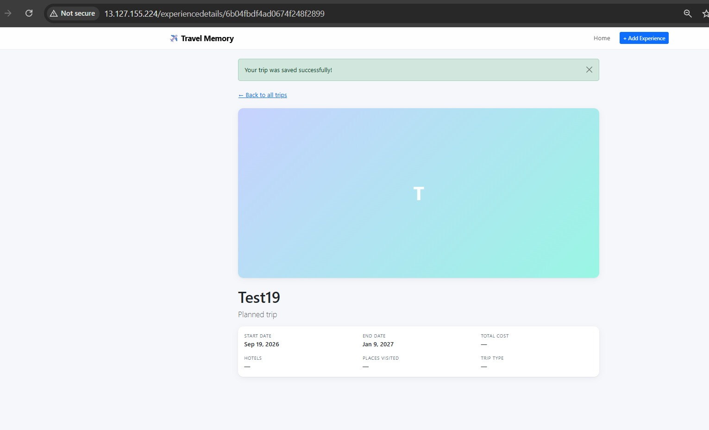
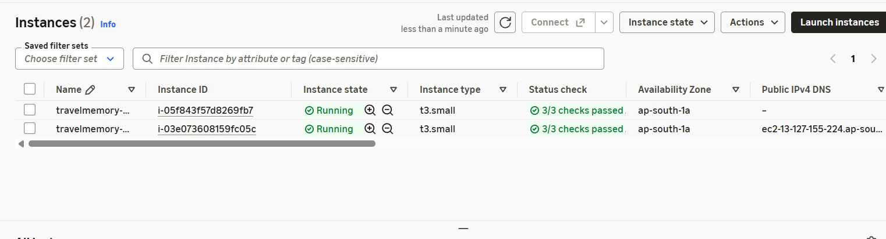
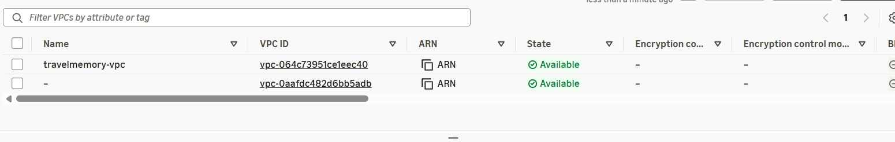
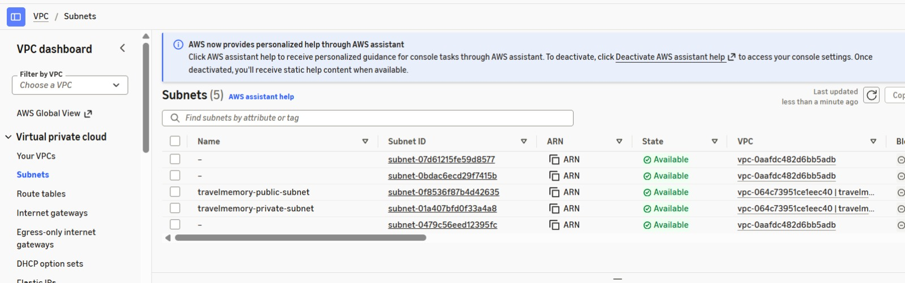
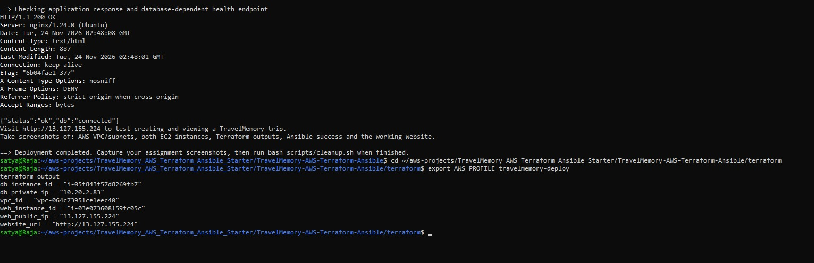
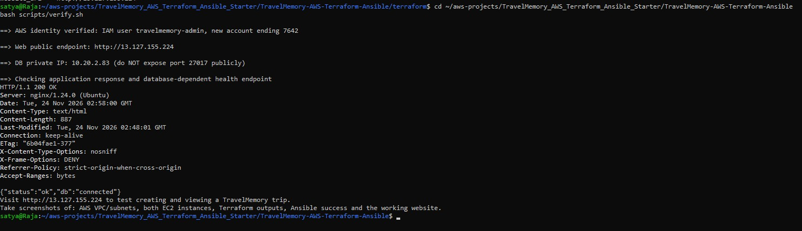

# Implementation Report: TravelMemory MERN Application on AWS

- **Project:** Deployment of a MERN application using Terraform and Ansible
- **Prepared by:** Drstrange1919 (GitHub project owner)
- **Completed:** 24 November 2026
- **AWS region:** Asia Pacific (Mumbai), `ap-south-1`
- **Repository:** [https://github.com/Drstrange1919/TravelMemory-AWS-Terraform-Ansible](https://github.com/Drstrange1919/TravelMemory-AWS-Terraform-Ansible)
**Project status:** **Deployment demonstrated and infrastructure cleaned up**

> **Historical deployment evidence.** The TravelMemory web application was deployed and tested on 24 November 2026, then the lab infrastructure was intentionally destroyed to avoid ongoing AWS charges. The temporary public endpoint mentioned below is **no longer live**. No credentials, private SSH keys, MongoDB passwords or Terraform state are included in this report.

---

## 1. Objective and scope

The assignment objective was to gain practical experience deploying the open-source [TravelMemory MERN application](https://github.com/UnpredictablePrashant/TravelMemory) on AWS using **Terraform for infrastructure automation** and **Ansible for server configuration and deployment**.

The required solution included an AWS VPC, public and private subnets, Internet and NAT gateways, route tables, two EC2 instances, restricted security groups, an EC2 IAM role, an application deployment, a secured MongoDB server, and evidence of the working website. This report describes the completed implementation, verification results, limitations and teardown.

**Outcome:** Terraform generated a **23-resource deployment plan** and the automated deployment finished successfully. Ansible configured the web and database hosts with **zero failed or unreachable tasks**. The Nginx website returned **HTTP 200**, and the application health endpoint returned `{"status":"ok","db":"connected"}`. After screenshots were collected, Terraform destroyed **23 managed resources** and an additional cleanup run found **0 remaining resources** in its state.

## 2. Technology stack

| Area | Implementation | Purpose |
|---|---|---|
| AWS region | `ap-south-1` (Mumbai) | Deployment location |
| Infrastructure as Code | Terraform 1.17.2; AWS provider 6.73.0 | Provisioning network, compute, access and IAM |
| Configuration management | Ansible Core 2.20.1 | Configure database and web/application hosts |
| EC2 operating system | Ubuntu Server 24.04, x86_64 | Both cloud instances |
| Web instance | EC2 `t3.small` | Nginx, Node.js/Express and React |
| Database instance | EC2 `t3.small` | MongoDB 8 Community Edition |
| Web frontend | React | TravelMemory user interface |
| Application backend | Node.js 22 and Express | Routes/API and database access |
| Database | MongoDB 8 | Authenticated travel-memory storage |
| Reverse proxy / service | Nginx; systemd | Web serving, API proxying, process startup |
| Local workstation | Windows PowerShell + Ubuntu WSL 2 | Terraform, AWS CLI, Ansible and Git |
| Version control | Git + GitHub | Project automation, evidence and documentation |

## 3. AWS architecture and network flow

```text
                                  Internet / browser
                                         |
                                   HTTP :80
                                         v
  AWS Region: ap-south-1        Internet Gateway
  VPC 10.20.0.0/16                     |
  +-----------------------------------+-----------------------------------+
  |                                                                       |
  |  PUBLIC SUBNET: 10.20.1.0/24                                         |
  |  +---------------------------------------------+                      |
  |  | Web EC2: t3.small / Ubuntu 24.04             |                      |
  |  | Public HTTP :80 -> Nginx -> React           |                      |
  |  | Nginx -> Express/Node :3001 (loopback)      |                      |
  |  +--------------------+------------------------+                      |
  |                       | authenticated MongoDB :27017                   |
  |                       v                                               |
  |  PRIVATE SUBNET: 10.20.2.0/24                                        |
  |  +---------------------------------------------+                      |
  |  | Database EC2: t3.small / Ubuntu 24.04       |                      |
  |  | MongoDB 8, private IP only, auth enabled    |                      |
  |  +---------------------------------------------+                      |
  |       | outbound software updates                                    |
  |       +----> NAT Gateway + Elastic IP in public subnet                |
  +-----------------------------------------------------------------------+
  Admin / WSL --> SSH :22 from admin /32 --> Web EC2 --> SSH ProxyJump --> DB
```

**Terraform-defined addressing:** VPC `10.20.0.0/16`; public subnet `10.20.1.0/24`; private subnet `10.20.2.0/24`. The private subnet used the NAT Gateway for outbound package downloads and did **not** assign a public IPv4 address to its database instance. The web instance exposed port 80 for the lab demonstration. Database port 27017 and database SSH port 22 were restricted to the web instance's security group. Web SSH port 22 was restricted to a single administrator `/32` IPv4 address.

**Application request flow:** A browser requested `/` from Nginx on the web instance; Nginx served the built React frontend. Requests to paths such as `/trip`, `/uploads` and `/health` were proxied to the local Express backend. The backend connected privately and with authentication to MongoDB. The health check tested web-to-backend-to-database connectivity.

## 4. Terraform infrastructure implementation

Terraform configuration files: [`terraform/main.tf`](../terraform/main.tf), [`variables.tf`](../terraform/variables.tf), [`outputs.tf`](../terraform/outputs.tf), and [`versions.tf`](../terraform/versions.tf).

**Provisioned resource categories:**

- Custom VPC, two subnets, Internet Gateway, NAT Gateway and Elastic IP.
- Public and private route tables and subnet associations.
- Web/database security groups, inbound rules and controlled outbound rules.
- One IAM role, an SSM-managed policy attachment and an EC2 instance profile.
- Two encrypted gp3-root-volume Ubuntu EC2 instances (20 GiB per instance), configured to require IMDSv2.

**Deployment configuration used:**

| Setting | Actual configuration during lab |
|---|---|
| Region | `ap-south-1` |
| Web instance | `t3.small`, Ubuntu 24.04, encrypted 20 GiB gp3 volume |
| Database instance | `t3.small`, Ubuntu 24.04, encrypted 20 GiB gp3 volume |
| SSH key | Existing imported ED25519 public key named `travelmemory-aws-key` |
| Administrator SSH | Restricted to the current public IP as `/32`; not open globally |
| AWS identity | Dedicated non-root IAM user with MFA, via `travelmemory-deploy` CLI profile |
| Terraform plan | **23 to add, 0 to change, 0 to destroy** |

Terraform supplied outputs for `web_public_ip`, `db_private_ip`, `website_url`, `web_instance_id`, `db_instance_id` and `vpc_id`. During verification the temporary public website address was **`http://13.127.155.224`**, and the database private IP was **`10.20.2.83`**. These are **historical demonstration addresses**, not active endpoints.

**Representative commands** (the automation wrapper performed provisioning and checks):

```bash
export AWS_PROFILE=travelmemory-deploy
cd terraform
terraform init
terraform fmt -check
terraform validate
terraform plan -out=tfplan
# The interactive deployment script obtained approval before applying a saved plan.
cd ..
bash scripts/preflight.sh
bash scripts/deploy.sh
```

The preflight script verified the AWS identity, existing EC2 SSH key, SSH CIDR, `$12` budget presence and Terraform configuration before any cloud resources were created.

## 5. Ansible configuration and deployment

The project used [`ansible/site.yml`](../ansible/site.yml) and templates in [`ansible/configuration/`](../ansible/configuration/). The deployment script generated an inventory from Terraform outputs, used the public web host as the SSH jump host to reach the private database host, and ran the Ansible playbook.

### 5.1 MongoDB database host

1. Installed required OS packages and MongoDB 8 from the official MongoDB apt repository.
2. Initialized separate MongoDB administrative and application users, using local deployment-time passwords rather than committing passwords to Git.
3. Enabled database authentication and bound the database to loopback/private interfaces rather than the internet.
4. Enabled and started `mongod` with systemd.
5. Permitted MongoDB connectivity only from the web security group over the private VPC network.

### 5.2 React/Express web host

1. Installed Nginx, Git and Node.js 22.
2. Cloned the [assigned TravelMemory application](https://github.com/UnpredictablePrashant/TravelMemory) during deployment.
3. Installed backend dependencies and created a protected backend `.env` with the authenticated MongoDB connection string.
4. Configured the Express app as a systemd-managed service.
5. Created a **2 GiB swapfile** to make the React build more reliable on the 2 GiB-RAM `t3.small` instance.
6. Built the React frontend and copied its output to the Nginx web directory.
7. Configured Nginx for the static frontend and API reverse proxy, verified its syntax, then enabled/restarted it.
8. Verified the app/database health endpoint through the local reverse proxy.

### 5.3 Automated deployment sequence

```text
bash scripts/deploy.sh
  -> Preflight checks
  -> Saved Terraform plan and cost warning
  -> Explicit DEPLOY confirmation
  -> Terraform infrastructure creation
  -> Ansible inventory / SSH connectivity test
  -> MongoDB / web host provisioning
  -> Verify HTTP homepage and /health response
```

**Observed Ansible result, 24 November 2026:**

| Target | OK | Changed | Unreachable | Failed | Skipped |
|---|---:|---:|---:|---:|---:|
| Database (`db1`) | 16 | 11 | 0 | 0 | 0 |
| Web (`web1`) | 33 | 25 | 0 | 0 | 2 |

The Ansible `PLAY RECAP` and endpoint result are recorded in the deployment screenshot at [`screenshots/Ansible.jpeg`](../screenshots/Ansible.jpeg).

## 6. Verification, evidence and acceptance results

| Assignment requirement / check | Observed result | Supporting evidence |
|---|---|---|
| Two EC2 instances and public/private subnets | Provisioned by Terraform | EC2, VPC and subnet screenshots |
| Terraform plan / apply | **23 resources planned and subsequently created** | Terraform terminal screenshot and successful deployment output |
| Ansible host configuration | `db1` and `web1` completed with zero failures | Ansible recap screenshot |
| Web homepage | HTTP **200 OK** from Nginx | Deployment verification output and homepage screenshot |
| API/database connection | `{"status":"ok","db":"connected"}` | `/health` output in deployment verification |
| TravelMemory user interface | Homepage and example travel-memory screenshots collected | UI screenshots |
| Database isolation | Configured without public IPv4 and with web-only SG ingress | Terraform code and VPC security configuration |
| Cleanup | **23 destroyed**; second run reported **0 remaining** | Cleanup terminal results |

**Evidence boundary:** A sample memory screenshot was collected, but the terminal evidence available for this report does not separately establish a page-refresh persistence test or comprehensive automated end-to-end tests. The health endpoint does establish connectivity to MongoDB at the time of testing. The repository provides repeatable deployment code; the original AWS deployment is intentionally no longer available.

### 6.1 Deployment screenshots in repository

The following seven JPEG files are present in the project's `screenshots/` directory and linked here using paths relative to the `report/` directory. When this report is committed, GitHub will display them in the Markdown report. The PDF report contains the evidence index but does not embed image data.

**1. TravelMemory homepage**



**2. Sample travel-memory entry**



**3. EC2 instances**



**4. AWS VPC**



**5. Public and private subnets**



**6. Terraform deployment evidence**



**7. Ansible results**



## 7. Security controls and limitations

**Controls implemented:** MFA-protected non-root deployment identity, restricted administrator SSH, private MongoDB network placement, MongoDB authorization, protected deployment passwords, private-key SSH, encrypted root EBS volumes, IMDSv2 and SSM-compatible EC2 instance profiles. Generated Terraform state, inventory files, credentials and secrets were excluded from Git.

**Lab limitations:** Public HTTP without TLS/HTTPS; no custom DNS name, load balancer, failover, managed database, automated backups or production-grade monitoring. The lab uses a single web instance and a single database instance and is not intended to be a production service. Application data on the EC2 database volume was removed as part of teardown.

## 8. Problems encountered and resolutions

| Issue | Resolution / learning |
|---|---|
| Initial AWS account returned `OptInRequired` for EC2 | Switched to a properly activated AWS account and verified EC2 API access before proceeding |
| AWS root login and IAM safety | Enabled root MFA, created a dedicated IAM deployment user with MFA and verified non-root AWS CLI identity |
| Sample administrator IP in `terraform.tfvars` | Replaced the documentation-only IP with the actual `/32` public IPv4; preflight verified the setting |
| Higher initial web EC2 size | Changed web and DB instances to `t3.small` to reduce lab cost; added web swap support for React build |
| AWS credit exposure from NAT/EC2 | Created a `$12` AWS budget, included cost warnings and required interactive deployment confirmation; destroyed lab resources after evidence collection |
| GitHub rejected HTTPS password authentication | Installed GitHub CLI, authorized browser-based login and pushed the Git commit using the authenticated credential helper |

## 9. Cost management and verified cleanup

**Budget configured:** `TravelMemory-Lab-Budget`, **$12 monthly**. The project used an AWS account with promotional credits, but the **actual final AWS cost / credit deduction was not independently verified** in the records available for this report. A budget is a warning system rather than an automatic cost cap; usage and billing data can arrive with delays.

**Teardown executed on 24 November 2026:**

```text
Destroy complete! Resources: 23 destroyed.
terraform -chdir=terraform state list
# No resources displayed.
bash scripts/cleanup.sh  # a second verification run
Destroy complete! Resources: 0 destroyed.
```

The verified Terraform state is empty, so the Terraform-tracked EC2 instances, gateways, Elastic IP, networking and associated managed resources have been removed. A separate AWS Console and billing review is still recommended for any out-of-band resources or delayed usage charges. The previously deployed website URL is no longer operational by design.

## 10. Lessons learned and next improvements

Terraform provided a reproducible, reviewable description of the AWS environment; Ansible configured the hosts and application after Terraform created the network and servers. Public and private subnet separation allowed the web service to be reachable while keeping MongoDB behind private network controls. Browser-based AWS/GitHub authentication and MFA helped avoid long-lived access keys. The successful health check demonstrated connectivity between Nginx, Express and MongoDB. Finally, the cleanup step reinforced the need to destroy lab infrastructure promptly.

For a production deployment, add HTTPS, DNS, managed secret storage, more restrictive IAM permissions, backups, monitoring/alarms, automated CI/CD, high availability and a durability strategy for user-uploaded files. Retain configuration in version control but never check in credentials or Terraform state.

## 11. Project and reference links

- **Final repository:** [https://github.com/Drstrange1919/TravelMemory-AWS-Terraform-Ansible](https://github.com/Drstrange1919/TravelMemory-AWS-Terraform-Ansible)
- **Original MERN application:** https://github.com/UnpredictablePrashant/TravelMemory
- **Terraform code:** [terraform/](../terraform/)
- **Ansible code:** [ansible/](../ansible/)
- **Screenshot evidence:** [screenshots/](../screenshots/)
- **AWS NAT Gateway pricing:** https://docs.aws.amazon.com/vpc/latest/userguide/nat-gateway-pricing.html
- **MongoDB Community Edition installation:** https://www.mongodb.com/docs/v8.0/tutorial/install-mongodb-on-ubuntu/

---

**Final assessment:** The assigned infrastructure and configuration automation were completed, the TravelMemory application served HTTP successfully with a connected MongoDB database, evidence was recorded, and all 23 Terraform-managed resources were removed after testing.
